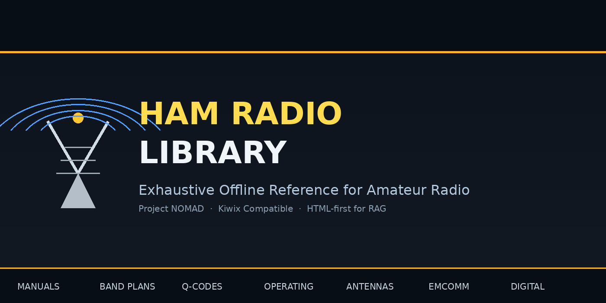

# ZIM-ham-radio-library



Offline ham radio / amateur radio reference library packaged as a ZIM for Project NOMAD's Kiwix Information Library.

## Goal

Create a high-quality, offline ham radio library that is fully usable by:

1. **Kiwix** — for human browsing, search, and offline reading of the reference material.
2. **NOMAD’s AI Assistant** — via full ingestion into the Knowledge Base / RAG system so the LLM can answer questions from the content.

**Hard requirement: high-value, ingestible content with visual accuracy.**  
NOMAD’s current ZIM extractor only indexes `text/html` and `application/xhtml+xml` entries. PDF-only collections produce almost no usable chunks for the LLM (see NOMAD issue #1445). Therefore this project is **HTML-first**.

Ham radio material is heavily visual (schematics, block diagrams, band-plan charts, antenna patterns, wiring diagrams, equipment photos, etc.). **Pictures and diagrams must be accurate.** Conversion is not acceptable if it loses, misplaces, or degrades figures. Preference is for **vector figures (SVG or equivalent)** over raw scanned raster images so diagrams stay sharp, editable, and usable at any zoom. The resulting HTML articles must preserve both the text and the visual information so that both Kiwix users and NOMAD’s AI Assistant receive reliable content.

This library is expected to process **thousands of source PDFs**. The conversion pipeline from PDF → clean, visually faithful HTML (with SVG/vector figures where practical) is the critical path. Everything lives in **one repository**. The conversion machinery (and original PDFs) stay in the repo but are **not packaged into the ZIM**. Only the resulting HTML (with embedded or linked figures) is packaged into the ZIM that both Kiwix and NOMAD consume.

## What this library is

An **exhaustive offline reference library for amateur (ham) radio**.

It is intended to be the single best offline source of practical and technical information a radio amateur or NOMAD’s AI Assistant would want in the field or without internet. Coverage aims to be broad and deep across the core domains of the hobby and service:

- Manuals and equipment references (transceiver, antenna, mode, and station manuals)
- Band plans and frequency allocations (all major regions and services)
- Operating procedures and best practices (HF, VHF/UHF, digital, contests, emergency)
- Q-codes, prosigns, abbreviations, and phonetic alphabets
- Callsign systems, licensing, and regulatory overviews
- Antenna theory, propagation, and station design
- Emergency and public-service communications (ARES, RACES, EmComm)
- Digital modes, software, and common protocols
- Troubleshooting and safety
- History, organizations, and supporting reference material

Every article is written or cleaned as self-contained HTML with accurate figures (prefer SVG/vector) so it indexes cleanly for RAG and remains usable for visual reference in Kiwix.

## Separation of concerns

Everything is in **one repository**. Two clear areas:

**Packaged into the ZIM / delivered by the NOMAD add-on install:**
- The ZIM structure and `install.sh` build/deploy path
- The browseable HTML index and article layout that Kiwix serves
- The final, clean HTML articles (with accurate figures) that NOMAD’s extractor indexes

**Kept in the repo for development only (never part of the add-on install):**
- Original PDFs
- Conversion pipeline (extraction, OCR where needed, diagram-to-SVG conversion, cleanup, quality checks)
- Intermediate files and notes

Finished articles are written into `html/articles/` (and linked from the index) for packaging. Only that finished HTML goes into the ZIM. The NOMAD add-on install delivers the ZIM (or the `html/` content needed to build it); it does **not** include `source/` or any conversion machinery.

## What we have so far

- Working project skeleton with `install.sh` that builds a ZIM via `zimwriterfs`.
- HTML index page + placeholder article structure.
- Clear boundary inside the repo: only finished HTML articles are packaged; original PDFs and conversion work stay outside the ZIM.
- Design decision documented: prefer HTML articles (with accurate SVG/vector figures) so the AI can actually use the content.

## Directory layout

```
.
├── install.sh              # Build ZIM + optional deploy to NOMAD (html/ only)
├── README.md
├── ADDON.md                # Add-on install and LLM ingest notes
├── Screenshot.png          # Banner image for the repo page
├── source/                 # Original PDFs + conversion work (NOT part of the add-on install)
│   ├── README.md
│   ├── CONVERSION.md       # How to turn PDFs into HTML + SVG figures
│   ├── pdfs/               # Original PDFs
│   │   ├── public/
│   │   │   ├── basic/      # ≤ 95 MB public PDFs, tracked in git (“batteries included”)
│   │   │   └── extensive/  # > 95 MB public PDFs; user supplies locally and converts
│   │   └── paid/           # Paid/DRM PDFs (any size); user supplies locally and converts
│   └── notes/              # Intermediate files / conversion notes
├── html/
│   ├── index.html          # Main browseable interface
│   ├── illustration.png    # 48×48 custom radio-tower icon for zimwriterfs
│   └── articles/           # Finished HTML pages (what Kiwix serves and the AI indexes)
│       └── example-band-plan.html
└── .gitignore
```

## Quick start

```bash
# Dependencies (on the machine that will build)
sudo apt install zim-tools python3

# Build the ZIM
chmod +x install.sh
./install.sh

# Deploy on a NOMAD host
./install.sh --deploy \
  --zim-dest=/opt/project-nomad/storage/zim \
  --container=nomad_kiwix_server
```

## Pipeline setup (for conversion work)

The ZIM build (`./install.sh`) only needs `zim-tools` and `python3`.  
The PDF → HTML pipeline under `source/` needs a virtualenv:

```bash
./source/setup.sh
source .venv/bin/activate
python3 source/pipeline/run.py source/pdfs/public/basic/ --category band-plans
```

See `source/README.md` and `source/CONVERSION.md` for details.

After deploy the ZIM is on disk, but it is **not yet usable by the LLM** until you ingest it:

1. In NOMAD, go to Content Manager / Knowledge Base.
2. Explicitly add the new ZIM (Manual ingest policy is the default on new installs).
3. NOMAD’s ZIM extractor indexes every `text/html` and `application/xhtml+xml` entry and turns them into RAG chunks.
4. Confirm chunks are created. If the count is near zero, the content is still mostly non-HTML and the LLM cannot use it.

Once chunks exist, the AI Assistant can answer questions from the library. Kiwix can browse the same HTML immediately after the ZIM is served.

## Making the content usable by the NOMAD LLM

The add-on install only places the finished ZIM. Usability by the LLM requires an explicit ingest step:

1. Source PDFs are converted to clean HTML (with accurate SVG/vector figures) and placed in `html/articles/`.
2. `./install.sh` builds a ZIM that contains only those HTML entries.
3. The ZIM is deployed to the NOMAD host (`--deploy` copies it to the Kiwix library directory and restarts the container if requested).
4. In NOMAD’s Content Manager / Knowledge Base you manually add the ZIM.
5. The extractor produces RAG chunks from the HTML. Those chunks are what the LLM uses.

**Verification:** after ingest, the Knowledge Base must show a non-trivial chunk count. Near-zero means the ZIM is still mostly non-HTML and the content is invisible to the AI. Kiwix browsing works independently of the chunk count.

This is why the project is HTML-first and why figures must be accurate inside the HTML: both the human interface (Kiwix) and the LLM (via chunks) consume the same articles.

## Content workflow (scale: thousands of PDFs)

Everything stays in this repo. Conversion work lives under `source/` and is never part of the NOMAD add-on install:

1. Place original PDFs in the correct location:  
   - `source/pdfs/public/basic/` (≤ 95 MB, tracked)  
   - `source/pdfs/public/extensive/` (> 95 MB; user supplies and converts)  
   - `source/pdfs/paid/` (any size; user supplies and converts)
2. Convert them (via the pipeline documented in `source/CONVERSION.md`) to clean, self-contained HTML with accurate figures (prefer SVG/vector).
3. Save finished articles under `html/articles/` (preserve useful structure/categories).
4. Link them from `html/index.html` so the library is browsable in Kiwix.
5. Rebuild the ZIM with `./install.sh` (only `html/` is packaged).
6. Deploy the ZIM only. The add-on install delivers the finished ZIM; it does not include `source/` or the conversion pipeline.
7. Verify both:
   - Kiwix can browse and search the content.
   - NOMAD Knowledge Base shows a non-trivial chunk count after ingest (near-zero means the content is still mostly non-HTML).

The same HTML articles serve both consumers. Kiwix uses them for the human interface; NOMAD’s extractor turns them into RAG chunks for the LLM.

## Next steps

- [ ] Gather source material into `source/pdfs/public/basic/` (≤ 95 MB), `source/pdfs/public/extensive/` (> 95 MB), or `source/pdfs/paid/`
- [ ] Define and implement a scalable PDF → clean HTML conversion pipeline that preserves figure accuracy (prefer SVG/vector) under `source/`
- [ ] Convert first real articles (manuals, band plans, Q-codes, basic operating procedures, etc.) into `html/articles/` and verify chunk production
- [ ] Improve the index UI (categories, search) for Kiwix browsing
- [ ] Test full RAG ingestion on a real NOMAD instance and verify chunk count
- [ ] Decide long-term handling of any remaining non-HTML material (keep outside ZIM, or wait for extractor improvements)

## Notes

- Keep articles clean and self-contained so they index well.
- The `install.sh` is intentionally simple for now; it can be extended later.
