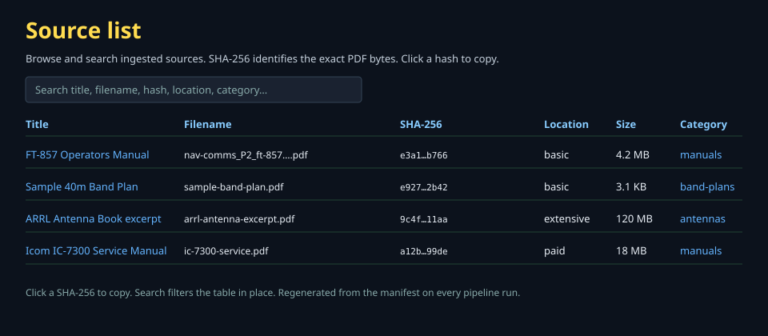

# PDF → HTML + SVG conversion

Document the pipeline here. All major design decisions below are locked.

## Requirements

- Output must be clean, self-contained HTML.
- Figures must be accurate. **Strict SVG / vector preference**: native vectors extracted as SVG; raster diagrams recreated as accurate SVG via AI (iterate until fidelity is met). Photos may remain high-quality raster only when vectorization adds no value.
- Finished articles go into `html/articles/` (hybrid topic taxonomy) and are linked from `html/index.html`.
- Only the finished HTML is packaged into the ZIM.
- Mostly automated batch processing with confidence scores and a review queue.
- Early content-based deduplication.
- Structured handling of multi-column layouts, footnotes, tables, and rotated pages.
- Metadata embedded in HTML + central manifest so RAG chunks retain source, page, figure, category, and topic context.

## Locked decisions

### Vectorization
Native vectors → extract as clean SVG.  
Raster diagrams / schematics / band plans / patterns / wiring → AI vectorization / recreation as accurate SVG. Iterate (prompt, model, or cleanup) until the result does not lose, misplace, or degrade information.  
Equipment photos may stay optimized raster when pure vector adds no value.

### Processing model
Default path is unattended batch: extract → (OCR if needed) → AI vectorize figures → assemble semantic HTML → quality checks.  
Emit confidence / quality scores at figure and document level.  
Items below threshold or explicitly flagged high-value go to a review queue for approve / reject / targeted re-run.

### Directory taxonomy (`html/articles/`)
Hybrid topic-based, shallow:

- `manuals/`
- `band-plans/`
- `operating/`
- `antennas/`
- `digital/`
- `reference/`
- `emergency/`

Optional second level only when a category grows large or a clear subgroup appears.  
Filenames stable and descriptive. Index (and future category pages) provide navigation; internal links use relative paths.

**Per-document assets.** Figures for a document live in a sibling directory named after the document id, not next to the HTML:

```
html/articles/manuals/
  {slug}.html
  {slug}/
    {slug}-page0-0.svg
    {slug}-page12-1.svg
```

The HTML references them as `{slug}/filename.png`. This keeps the category folder flat (one HTML per source) and scales to thousands of documents × dozens of figures. A document id has exactly one article. On a category change the old article and its asset directory are deleted; the new ones are written in the new category. An empty old category directory is removed.

### Deduplication
Early, before expensive stages.  
- Exact: SHA-256 of raw PDF bytes.  
- Near-duplicates: text-layer fingerprint (MinHash / SimHash / embedding) + visual/perceptual hash for diagram-heavy or low-text PDFs.  
Prefer higher-quality canonical source (more text, higher resolution, native vectors, later date, etc.).  
Record relationships in a manifest (JSON or SQLite). Only the canonical version proceeds. Review queue can override.

### Layout, tables, footnotes, rotation
Detect via PDF library layout analysis (PyMuPDF or equivalent): columns, blocks, tables, rotation.  
- Reading order: visual sort (top-to-bottom, left column fully before right).  
- Footnotes: extract separately; prefer inline HTML footnotes with anchors.  
- Tables: structured HTML `<table>` when possible; high-quality image + text fallback + review flag otherwise.  
- Rotation: auto-normalize text extraction and figure rendering before vectorization.  
Quality checks for column-order sanity, table presence, footnote resolution. Low-confidence pages to review queue.

### Metadata
Central manifest (same store as dedup) + embedded in HTML:

- Document: title, source/manual name, equipment/entity, version/date if known, canonical ID.  
- Category: primary from directory (`manuals`, `band-plans`, etc.).  
- Topics / tags: secondary multi-value list (e.g. `hf`, `transceiver`, `icom`, `region-2`).  
- Section / page / figure: heading hierarchy, original page numbers where useful, figure number + caption + “SVG recreation” note.  
- Processing (optional): confidence, OCR used, AI vectorization used.

Visible in article header for Kiwix; machine-readable via meta tags or structured block for the extractor. Supports coherent RAG chunks (“from the IC-7300 service manual, section 5.2, original page 37, figure 5-4”).

## Pipeline stages (sketch)

1. **Ingest / staging** — Place the PDF in the correct directory:  
   - `source/pdfs/public/basic/` (≤ 95 MB, tracked)  
   - `source/pdfs/public/extensive/` (> 95 MB, local only)  
   - `source/pdfs/paid/` (any size, local only)  
   Compute hash + fingerprint immediately. Update the manifest. Skip or flag exact/near-duplicates.  
   Extensive and paid files are supplied by the user and ingested the same way; they are simply never committed.
2. **Triage** — Detect text layer vs. scanned, page count, vector presence, complexity, rotation. Assign initial category/topic hints if possible.
3. **Extract** — Text + structure (blocks, reading order), images, native vector paths → SVG. Table detection. Footnote regions.
4. **OCR** (conditional) — For pages with no usable text layer.
5. **Figure handling / vectorization** — Native SVG kept. Raster diagrams → AI vectorization to accurate SVG. Iterate to quality. Photos optional raster.
6. **HTML assembly + cleanup** — Semantic structure (headings, paragraphs, lists, tables, figures with captions). Embed metadata. Consistent styling. Self-contained where practical. Relative links.
7. **Quality gates** — Automated checks (text length, figure presence/accuracy signals, layout sanity, metadata completeness). Low scores or flags → review queue.
8. **Publish** — Write canonical HTML under the appropriate `html/articles/<category>/…`. Update `html/index.html` (or category indexes). Record final paths and metadata in manifest.
9. **Build & verify** — `./install.sh` packages only `html/`. Confirm Kiwix browsing and non-trivial RAG chunk count after NOMAD ingest.

## Tools (starting point, subject to refinement)

- Core PDF: PyMuPDF (fitz) for extraction, layout, vectors, rendering.
- Fallback / cross-check: Poppler (`pdftohtml`, `pdftocairo`).
- OCR: Tesseract or modern model-based (Docling / equivalent) as needed.
- Vectorization: AI image-generation / vector models for raster-to-SVG recreation; classical vectorizers only as assist.
- Manifest: JSON or SQLite.
- HTML: direct generation + light cleanup (no absolute-positioned dumps).

## Notes

Quality over speed on figures. Accuracy is the hard requirement; automation and scores protect throughput.  
Manifest is the single source of truth for dedup, canonical choice, metadata, and processing history.  
Next concrete step: prototype the ingest → extract → one AI vectorization → HTML path on a small set of representative PDFs (clean manual + diagram-heavy page + scanned page) and validate both visual fidelity and RAG chunk quality.

## Current pipeline (2026-11-09)

Working path under `source/pipeline/`:

- `ingest.py` — SHA-256 identifies a document. Category lives in the manifest. `--category` sets or changes it.
- `extract.py` — body, headings, reading order, and tables from `pymupdf4llm` with the `pymupdf-layout` engine activated. Figures are high-DPI PNG clips of diagram regions.
- `toc.py` — leader-dot TOC lines become Markdown list items.
- `style.py` — heading ids, TOC links, sticky sidebar nav, native dialog lightbox.
- `assemble.py` — Markdown to HTML, figures placed per page, style layer applied.
- `run.py` — end-to-end entrypoint.

**Python 3.10–3.13 is required.** `pymupdf-layout` depends on `onnxruntime`, which has no wheel for Python 3.14+. `setup.sh` fails fast outside that range.

Setup (once per clone, with Python 3.13):
```bash
python3.13 -m venv .venv
./source/setup.sh
source .venv/bin/activate
```

Run (full document by default):
```bash
python3 source/pipeline/run.py source/pdfs/public/basic/nav-comms_P2_ft-857-operators-manual.pdf --category manuals
```

Outputs:
- `source/manifest.json`
- `html/articles/<category>/<id>.html` plus a sibling directory of PNG figures
- index and sources pages rebuilt

Validated on the FT-857 operator manual: full extraction, TOC as linked lists, sticky sidebar, figure lightbox, Specifications as a heading and table.

## Figure extraction rule (locked)

Single source of truth in `source/pipeline/figures.py`:

- A figure region is the tight union of native vector drawing items.
- Text whose bounding box intersects that region (plus a small margin) is a figure label.
- Everything else is body text.
- The diagram SVG contains only the vector items inside the region plus those labels.
- The same classification is used for both HTML body text and SVG content. No second filter, no content-specific word lists.

## Running the pipeline

```bash
python3 source/pipeline/run.py <path> [--category NAME] [--pages N] [--html-root DIR]
```

`<path>` is a single PDF or a drop-zone directory. A directory processes every PDF in it (flat; no category subfolders).

```bash
# every PDF in basic/; category comes from the filename prefix
python3 source/pipeline/run.py source/pdfs/public/basic/

# override one file
python3 source/pipeline/run.py source/pdfs/public/basic/some-manual.pdf --category operating
```

### Flags

- **positional `<path>`** — a PDF file, or a drop zone (`source/pdfs/public/basic/`, `.../extensive/`, or `source/pdfs/paid/`). Drop PDFs flat in one of those three. Do not create category subdirectories.
- **`--category NAME`** — optional override. Sets or changes the topic and stores it in the manifest. On a change, the pipeline removes that document's files from the old category and deletes the old directory only if it is empty. Valid names: `manuals`, `band-plans`, `operating`, `antennas`, `digital`, `reference`, `emergency`.

Category comes from the filename prefix when `--category` is omitted. The map lives in `source/pipeline/categories.py`:

| Prefix | Category |
|--------|----------|
| `manual` | `manuals` |
| `tutorial` | `operating` |
| `reference` | `reference` |
| `book` | `reference` |
| `article` | `reference` |

`nav-comms_manual_yaesu_ft-857.pdf` is `manuals`. A file that does not match `nav-comms_<prefix>_…`, or whose prefix is not in the map, stops. Pass `--category` to override. The manifest still wins for a file that already has a category, unless `--category` is passed.
- **`--pages N`** — max pages to extract per PDF. Default is 5 (prototype). Omit only when you want the full document.
- **`--html-root DIR`** — where finished HTML is written. Default is `html/`.

A directory run skips a file that already has an article. Drop new PDFs in and run the same command; only the new ones are processed. To rerun one file, pass that file and `--force`. `--force` on a directory reprocesses every file. A `--category` change still reprocesses that file so the article moves.

```bash
# rerun one file
python3 source/pipeline/run.py source/pdfs/public/basic/nav-comms_manual_yaesu_ft-857.pdf --force
```


## Document title

The title is the largest specific line that identifies the document, not the first heading and not the PDF info-dictionary title.

- The info-dictionary title is untrusted. It is often a path or a filename.
- The first heading is often a generic cover word (`OPERATING MANUAL`) that is the same on every manual of a series.
- A line that appears on more than one early page is a running title. That is preferred, because it identifies the document rather than a section.
- Generic cover words (`OPERATING MANUAL`, `INTRODUCTION`, `CONTENTS`, `SPECIFICATIONS`) are skipped.
- Fail Fast if no specific line is found on the first six pages.

The resolved title is stored on the manifest record and used for the article `<h1>`, the `<title>`, and the index. The index therefore shows `FT-857 Operating Manual`, not `OPERATING MANUAL`.

When two documents resolve to the same title, the filename's variant is appended so they stay distinguishable: `US Amateur Radio Bands (bw, 11x8)` and `US Amateur Radio Bands (color, 11x8)`. The other document is updated at the same time. Fail Fast if the titles collide and the filename has no variant.

## Charts and posters

A one-page PDF is a chart or poster, not a reflowable manual. Reflowing it into paragraphs destroys the chart.

- The page is rendered at high DPI and is the article. It is full width and opens in the same lightbox as other figures.
- The extracted text is placed in a closed "Extracted labels (for search)" block so search and the RAG can index the labels without showing the broken reflow.
- Diagram extraction is skipped. The page image is the content.

Multi-page PDFs follow the normal extract-and-reflow path.

`html/sources.html` is a searchable list of every ingested source, generated from the manifest and packaged into the ZIM. It is the public view of what the library contains.

Columns:

- **Title** — document title (from the record, or filename stem)
- **Filename** — original PDF name
- **SHA-256** — exact file identity; click to copy
- **Location** — drop zone: `basic`, `extensive`, or `paid`
- **Size** — file size
- **Category** — topic taxonomy (`manuals`, `band-plans`, etc.)

A search box filters the table by any of those fields. The page is regenerated at the end of every pipeline run; do not edit it by hand.




## Locked implementation decisions (2026-11-08)

These decisions are locked and implemented in `source/pipeline/`.

### Full-document text extraction
Default is the entire document. `--pages N` is an explicit debug-only limit and requires `--debug`. Using `--pages` without `--debug` is a hard failure (Fail Fast). Documented in `run.py` help and here.

### Reading order
Single source of truth: `source/pipeline/layout.py` (`column_order`).  
Gap-based column detection: the vertical gap between columns is found first, then each block is assigned by its center. Left column is emitted fully, then the right. This handles TOC pages where block bboxes are wide (leader dots) but centers still fall into columns. A block center that falls in the gap raises `UnclassifiableLayout` (Fail Fast). The same function is used for body text and for interleaving figures.

### Figure placement
Figures are first-class elements in a per-page ordered sequence. `assemble.py` builds a mixed list of text blocks and figures for each page and sorts it with `column_order`. Figures appear after the text that precedes them on the page in reading order, not at the end of the article.

### SVG quality
Conservative pure-Python optimizer in `source/pipeline/svg_optimize.py`. Implements the safe subset of SVGO (remove metadata, comments, empty groups, editor namespaces; round decimals to 2; preserve `viewBox` and `clipPath`). No new runtime. Malformed SVG raises `BadSVG` (Fail Fast). The function is the single place for SVG cleanup.

### Captions
`_caption` in `assemble.py` produces "Figure from page N" plus at most two short labels (each ≤ 40 characters) that intersect the region. Longer dumps (button clusters, body text) are dropped. Page number is always present; missing page association is a hard failure.

### Code knowledge graph (Graphify)
Graphify (`graphifyy` on PyPI) is part of the pipeline setup. It builds a local AST knowledge graph of `source/pipeline/` with no LLM required for code.  
Install via `./source/setup.sh` (it is in `source/requirements.txt`).  
Run with `./source/graphify.sh` or `graphify extract source/pipeline`.  
Output: `source/pipeline/graphify-out/graph.json`.

## Prototype status (updated)

- `layout.py` — column-aware reading order (single source of truth).
- `svg_optimize.py` — conservative SVG cleanup (SVGO safe subset).
- `extract.py` — full-document extraction by default; uses `column_order`; optimizes SVGs; returns figure metadata (path, page, bbox, labels).
- `assemble.py` — per-page ordered sequence of text and figures; semantic captions.
- `run.py` — `--pages` is debug-only and requires `--debug`.
- `structure.py` — font-size headings (h2/h3), page-chrome removal, dehyphenation, button-cluster caption filter. Fail Fast if body font cannot be determined.

## Body extraction (2026-11-08)

Body text, headings, reading order, and tables come from `pymupdf4llm.to_markdown` with page margins to drop chrome. Markdown is converted to HTML with the standard `markdown` library. We do not hand-roll heading or reading-order logic.

Figures are high-DPI PNG of each diagram region (`page.get_pixmap(clip=…, dpi=200)`). Clipped SVG from `get_svg_image` is incomplete; a pixmap of the region is the usable output. Region filters (rule, barcode, path-art, body text) are unchanged.

## Article style (2026-11-09)

The assembler post-processes the HTML: headings get stable ids, TOC list items become links to those ids, a sticky sidebar nav is built from the TOC, and each figure opens a native dialog lightbox. No external CSS or JS. Body text stays in the main flow so Kiwix and the NOMAD extractor still see the full article.
